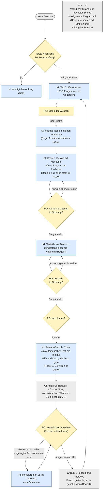

# Working mode

How the product owner (PO) and the AI developer work together on a feature. The binding rules for the AI are in [`CLAUDE.md`](../CLAUDE.md); this page is the overview for the PO. Introduced with #12.

## Principles

- **Every GitHub issue is a requirement. No work without an issue.** If the PO asks for something in the conversation that has no issue yet, the AI creates it first.
- **The issue is the record.** Every proposal, design (with screenshots of the mockups), open question, decision, test case and approval is posted in the issue, not only in the conversation.
- **The PO checks twice:** the test cases before building, and the result in the pull request. Nothing in between.

## Overview

The whole flow at a glance (#43). The diagram is for the PO and therefore in German (see "Language" in `CLAUDE.md`). Yellow: the PO decides; blue: the AI works; grey: GitHub. The labels on the arrows are the commands; the rules in brackets are the steps of the workflow in [`CLAUDE.md`](../CLAUDE.md).



Legende: gelb = du (PO) entscheidest · blau = die KI arbeitet · grau = GitHub. Wenn sich ein freigegebenes Abnahmekriterium oder ein Testfall ändern müsste, geht es immer zurück zu dir zur Freigabe (Regel 5).

## Session start

The AI cannot write first; a session starts with the PO's first message. If that message has no concrete task (for example "Hallo" or "Was steht an?"), the AI answers with an overview: the **top 5 open issues** of the backlog, each with its state and a short assessment, followed by **2–3 questions or suggestions** on how the product could continue. The PO can ask for the same overview at any time with `/start`. A first message with a concrete task is worked on directly. Introduced with #41; the instructions are in `.claude/skills/start/SKILL.md`.

## Commands

The PO can use short commands in the chat. They are shortcuts: plain sentences ("passt", "bau es") mean the same. The PO only talks in the chat; the AI records every decision in the issue. Introduced with #43; the instructions are in `.claude/skills/`.

| Command | Step | What the AI does |
|---|---|---|
| `/start` | – | Top 5 open issues and 2–3 questions on how to continue |
| `/hilfe` | – | Lists and explains the commands. The commands are German because `/help`, `/status` and `/feedback` are built into Claude Code and would take precedence |
| `/neu <text>` | 1–2 | Creates the issue in the PO's words, proposes stories, asks the open questions |
| `/freigabe #<n>` | 3, 5 | Records the approval of the acceptance criteria (then proposes test cases) or of the test cases (then asks whether to build) |
| `/go #<n>` | 5–7 | Builds the feature and opens the pull request with the preview link |
| `/korrektur #<n> <text>` | 8 | Records the feedback in the issue, fixes it, posts the new preview link |
| `/abgenommen #<n>` | 8–9 | Records the acceptance, merges the pull request, deletes the branch; the issue closes |
| `/stand #<n>` | – | State, what is open, next step |
| `/design-vorschlag <number> [text]` | 2 | Publishes an Artifact with the asked number of design variants (1–x, options A–D), each rated, with a clear recommendation; documents it in the issue; the PO confirms the recommendation interactively |

## Questions are interactive

Every question the AI asks the PO goes through the question tool with short, selectable options, never as a plain text list (#50). This lets the PO answer by tapping, also from a phone. Free text is only for "Other". The AI records the answers in the issue.

## Steps

| # | Who | What | Where |
|---|---|---|---|
| 1 | PO | Writes the issue: goal, notes, draft acceptance criteria (template "Feature") | Issue |
| 2 | AI | Proposes stories, design and phases, asks open questions | Issue comment |
| 3 | PO | Answers the questions (the AI asks them interactively with selectable options), approves the acceptance criteria | Conversation or issue; the AI records it in the issue |
| 4 | AI | Proposes one or more **test cases per acceptance criterion**, in German and plain language | Issue comment |
| 5 | PO | Reviews the test cases from a testing perspective; they are revised until the PO approves them and gives the go | Conversation or issue; the AI records it in the issue |
| 6 | AI | Builds the feature in one go, without intermediate checks. Turns every test case into at least one automated test with the same ID | Feature branch |
| 7 | AI | Opens a pull request starting with `Closes #<issue>`, with the acceptance checklist, the test case IDs and the tests that cover them, the web preview and the Windows build | Pull request, linked in the issue |
| 8 | PO | Tests in the web preview (and the Windows app if the pull request says so) and approves. The preview has an "Abnahme" panel at the bottom left: every test case with a link to its page, a tick box and a comment; Test cases that need other data than the demo data (for example several completed sprints) name test data (`src/acceptance/presets.ts`) that the panel loads with one button, or the PO picks from "Testdaten"; the preset replaces the data in that browser and never belongs to the product. "Ergebnis kopieren" gives the result as text that the PO pastes back into the chat with the AI (no detour through the issue; the AI records it) | Preview, pull request or conversation |
| 9 | AI | Merges with "Rebase and merge", the only merge method enabled (the branch stays linear); GitHub closes the issue; image links in the issue switch from the branch to `main`, then the branch is deleted | GitHub |

If something during building would change an approved acceptance criterion or test case, the AI stops, updates the issue and asks the PO again.

## The help

The interactive help (question mark in the header) grows with every feature, like the technical documentation: every pull request that changes what a user sees also adds or updates its help topics in DE, EN, FR and IT, with links to where to find the feature and, where a feature has to be switched on first, that step first. The topics of the **first steps (tutorial)** are different: the AI never adds or changes a step on its own. It asks the PO first, with short interactive questions, and builds only after an explicit approval.

## A test case

Each test case has an ID (`AC<n>.<m>`, or the requirement ID such as `FR-MAP-02.1` for existing behaviour), a title and three parts in plain German:

```markdown
**AC2.1 Story per Drag & Drop auf Erledigt ziehen**
- Ausgangslage: Story „S-3 Login-Seite“ steht in der Spalte „In Arbeit“.
- Ich mache: Ich ziehe „S-3“ in die Spalte „Erledigt“.
- Erwartet: „S-3“ steht in „Erledigt“, auch nachdem ich die App neu geladen habe.
```

Variations go into a small table. Test cases that are checked by hand are marked *(manuell)* with a reason. Open questions that come up while writing test cases are listed below them.

## How test cases become tests

| Level | When | Where |
|---|---|---|
| End-to-end | Journeys across pages, drag and drop with the mouse, reloads | `e2e/*.spec.ts`, Playwright in a real Chromium, `npm run test:e2e` |
| Component | One page or dialog, keyboard, screen reader texts | `src/**/*.test.tsx`, Vitest, `npm test` |
| Unit | Rules and calculations | `src/domain/*.test.ts`, Vitest |

The name of every test starts with the ID of its test case, and `docs/requirements/` lists it under "Verified by". CI runs all levels on every push. In the cloud sessions of the AI the npm registry is not reachable, so there CI on GitHub is the only place where the tests run: the AI pushes the branch and fixes until the CI is green (#67).
